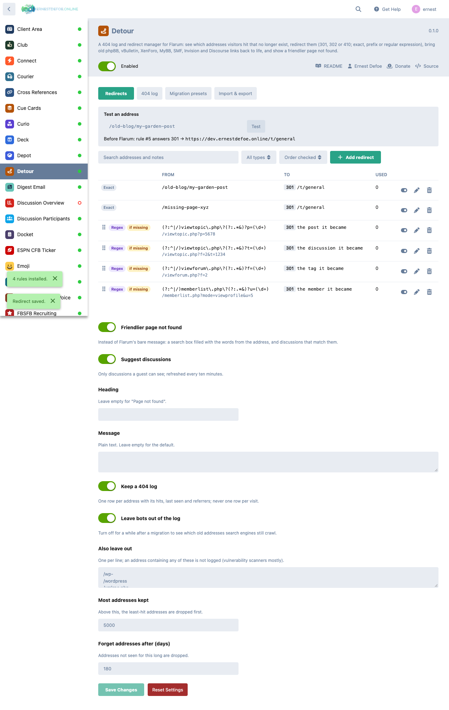
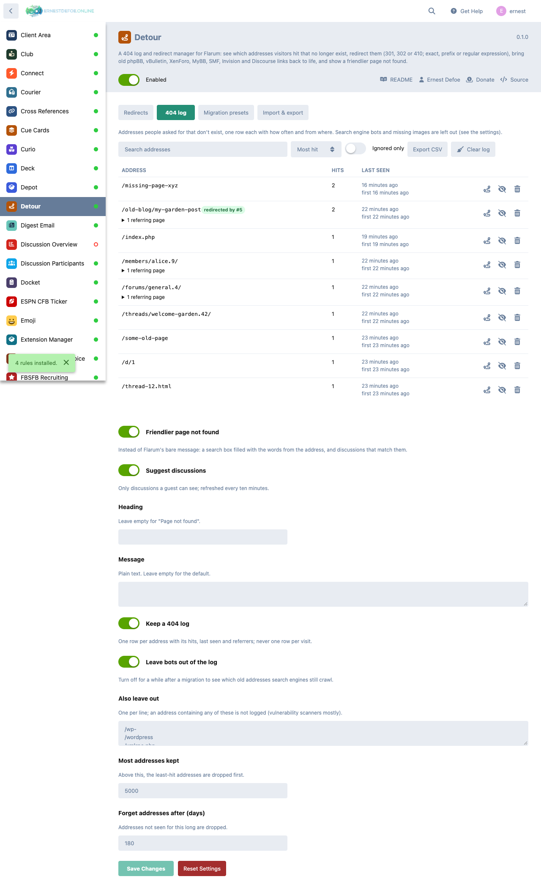
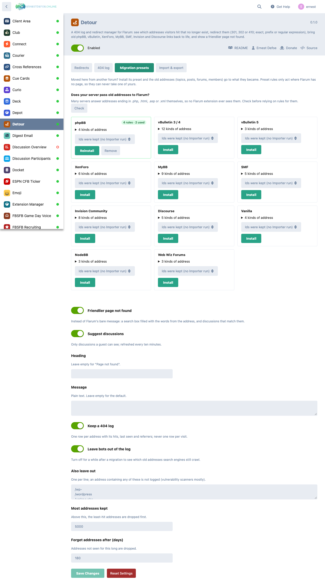

# Detour

**A 404 log and redirect manager for Flarum 2.**

Every forum loses addresses: a discussion is merged, a tag is renamed, a page is retired, or the whole forum moved here from phpBB, vBulletin, XenForo, MyBB, SMF, Invision or Discourse. The old links keep arriving from search engines, bookmarks and other sites, and Flarum answers every one of them with a bare "not found". Nobody hears about it, and the traffic quietly goes away.

Detour shows you which addresses people are asking for, lets you send them somewhere useful, and gives the ones you haven't caught a page that helps.



## What it does

- **A 404 log, kept small.** One row per missing address with its hit count, when it was first and last seen and its last few referring pages. A visit updates the row; it never adds one. The log is capped (least-hit addresses go first) and forgets addresses not seen for a while. Search engine bots, missing images and vulnerability scanners are left out, and each of those is a setting.
- **Redirects: 301, 302 or 410 (gone).** Match an exact address (case and a trailing slash don't matter; add `?a=1` to match one query), a prefix (`/old` covers `/old/anything` and carries the rest across), or a regular expression with `$1`, `$2` … in the target.
- **Before Flarum, or only where Flarum has no page.** "Always" rules answer before routing; "only if missing" rules act only when Flarum would have shown a 404, so they can never take one of your real pages.
- **One click from the log.** Each logged address has a "Redirect it" button, and the log shows which addresses a rule now covers.
- **Test an address.** Type any address and see what the forum would do with it: which rule, which status, where to.
- **Chains collapse, loops are refused.** `/a → /b → /c` is sent as one redirect to `/c`. A rule that would lead back to itself, directly or through others, can't be saved, and a loop is never served.
- **A friendlier page not found.** Your own heading and message, a search box already filled with the words from the address, and discussions whose titles share them (only ones a guest can see).
- **CSV import and export**, with a "check only" pass that lists bad rows by line before anything is saved.



## Moving from another forum

Install a **migration preset** and the old forum's addresses for topics, posts, forums and members go to what they became here. Presets cover phpBB, vBulletin 3/4 and 5, XenForo, MyBB, SMF, Invision Community, Discourse, Vanilla, NodeBB and Web Wiz Forums.

If you moved with [Importer](https://github.com/ernestdefoe/importer), choose its run and old ids are mapped to the new ones through the Importer's own id tables. If your ids were kept, leave the run empty. Tags and members are only looked up when a guest could see them, and a post only when it isn't private or hidden.



### Does your server pass old addresses to Flarum?

Many servers answer addresses ending in `.php`, `.html` or `.xml` themselves, so no Flarum extension ever sees them. The presets page has a **Check** button that asks your server and tells you which ones reach Flarum.

On nginx, old `.php` addresses (phpBB, vBulletin, MyBB, SMF) need one line changed in the block that passes `.php` files to PHP:

```nginx
location ~ \.php$ {
    try_files $uri /index.php?$query_string;   # was: try_files $uri =404;
    ...
}
```

Existing `.php` files still run as before; only missing ones go to Flarum. Don't add a separate `.php` block that serves files directly, which would hand out source code. Apache with Flarum's `.htaccess` needs nothing.

## Light on your forum

- **No forum JavaScript, no forum CSS, nothing added to the page payload.** Everything is on the admin page.
- **No queries on a normal page view.** The rules are compiled once into Flarum's cache and matched in memory; the database is read again only after a rule changes. A redirect costs one write (its hit counter); a logged 404 costs two.
- Redirects are answered before the session starts, so they set no cookie.
- A 301 is cached by browsers for a day rather than forever, so a mistaken rule doesn't follow visitors around after you fix it. Search engines still read it as a permanent move.
- Detour never touches `/api`, `/admin`, `/assets` or the log-in, reset and confirmation pages.

## Safe by design

- Targets are paths on your forum unless you tick **Allow another site** for that rule, and then only to the host you wrote: a `$1` can never stand in for a host, and a capture can never turn a path into `//another-site`.
- Captures are re-encoded before they go into a `Location` header.
- Everything is admin-only; the log keeps referring pages without their query strings.

## Install

```
composer require ernestdefoe/detour
```

Then enable **Detour** in the admin panel.

## Update

```
composer update ernestdefoe/detour
php flarum migrate
php flarum cache:clear
```

## Links

- [Source](https://github.com/ernestdefoe/detour)
- [Report an issue](https://github.com/ernestdefoe/detour/issues)

Free and open source under the MIT licence.

☕ [Buy me a coffee](https://buymeacoffee.com/ernestdefoe)
